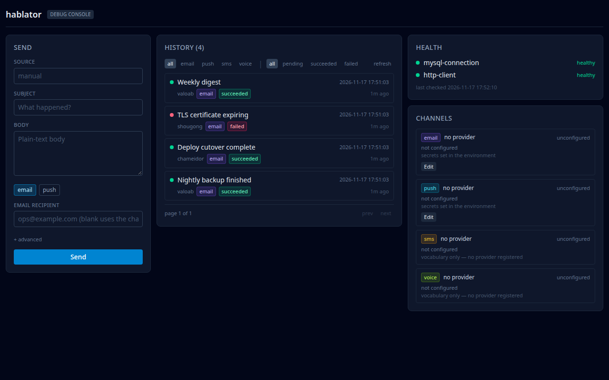

# hablator

Notification hub for the homelab: it takes send requests from other projects and delivers them through channels, recording the history of every delivery attempt.



## Quickstart

Prerequisites: Node 22, `uv`, and Docker (for MySQL).

```bash
npm run setup       # npm install in frontend/ + uv sync in backend/
npm run db          # start MySQL on host 8142
npm run db:migrate  # apply the Alembic migrations
```

Then, in two shells:

```bash
npm run be:run      # API      -> http://localhost:8140
npm run fe:dev      # debug UI -> http://localhost:8143 (proxies /api to the API)
```

The local ports are hablator's assigned block, recorded in [`.salgadinhos/ports.json`](.salgadinhos/ports.json): `api` 8140, `web` 8141, `mysql` 8142, `frontend-dev` 8143. Only the published side of a compose mapping varies — container-internal ports stay fixed — and a gitignored `.env` may override a host port locally.

## Checks

```bash
npm run be:check   # backend: ruff, mypy, import-linter, unit tests
npm run be:test    # backend: all tests (the integration suite needs a Docker daemon)
npm run fe:check   # frontend: typecheck, lint, unit tests
npm run fe:build   # frontend: production build
npm run check      # the canonical all-checks command, mirroring pre-commit (excludes be:test)
```

## How it fits

The hub is the family's single outbound channel: sibling projects call it instead of holding provider credentials themselves, and chameidor drives the legacy `POST /send-email` path. The seam that matters is the wire contract — that adapter keeps existing callers byte-compatible, and the new API's DTOs are mirrored by hand in `frontend/src/api/types.ts`. Navigation: [docs/code-map.md](docs/code-map.md) indexes both lanes.

## Limits

- The container path — one image, `supervisord`, nginx-injected Bearer token, Docker Hub publish — is not part of the Quickstart: [Docker runbook](docs/runbooks/docker.md).
- The push channel needs a reachable ntfy server and a configured topic; an unconfigured push channel answers a validation error: [ntfy provisioning](docs/ntfy-provisioning.md).
- Retry is modeled and classified here, executed by chameidor; this repo records attempts, it does not re-attempt.
- `sms` and `voice` exist only in the channel vocabulary — no provider is wired.
- The backend's integration suite needs a Docker daemon and never auto-skips.
- The deploy cutover to the combined image lands in the `iac` repo: [cutover note](docs/deploy-cutover.md).

## Docs

- [AGENTS.md — hablator monorepo](AGENTS.md) — open it when you need the repo conventions, tooling and the one cross-cutting rule.
- [Hablator — notification hub](CONTEXT.md) — open it when a domain term needs the project's exact vocabulary.
- [Code map](docs/code-map.md) — open it when you need a module, the files that matter or the seam a change crosses.
- [Code map (backend)](backend/docs/code-map.md) — open it when locating a backend module, its files or the seam a change crosses.
- [Code map (frontend)](frontend/docs/code-map.md) — open it when locating a frontend module or its entry points.
- [AGENTS.md — Python scaffold](backend/AGENTS.md) — open it before touching `backend/`.
- [Coding standards — Python lane](backend/CODING_STANDARDS.md) — open it when writing Python idioms the tooling does not enforce.
- [Hablator HTTP API](backend/docs/api.md) — open it for the endpoint and payload reference.
- [Observability — logging & metrics](backend/docs/observability.md) — open it before adding or changing anything that emits telemetry.
- [AGENTS.md — React scaffold](frontend/AGENTS.md) — open it before touching `frontend/`.
- [Coding standards — React lane](frontend/CODING_STANDARDS.md) — open it when writing React/TypeScript idioms the tooling does not enforce.
- [Decisions](docs/adr/) — open it when you need the reasoning behind an irreversible choice.
- [Acceptance runbook](docs/runbooks/acceptance.md) — open it to boot the stack the way acceptance does.
- [Docker runbook](docs/runbooks/docker.md) — open it to build the image or publish it.
- [Deploy cutover](docs/deploy-cutover.md) — open it when the `iac` stack moves to the combined image.
- [ntfy provisioning checklist](docs/ntfy-provisioning.md) — open it when standing up the push provider.

## Related projects

- [chameidor](https://github.com/luiznaac/chameidor) — the retry executor and the consumer that drives the legacy send path.
- [iac](https://github.com/luiznaac/iac) — the homelab deploy that runs this image.
- [environments](https://github.com/luiznaac/environments) — the scaffolds both lanes were instantiated from.
- [salgadinhos](https://github.com/luiznaac/salgadinhos) — the family conventions and agent tooling.
